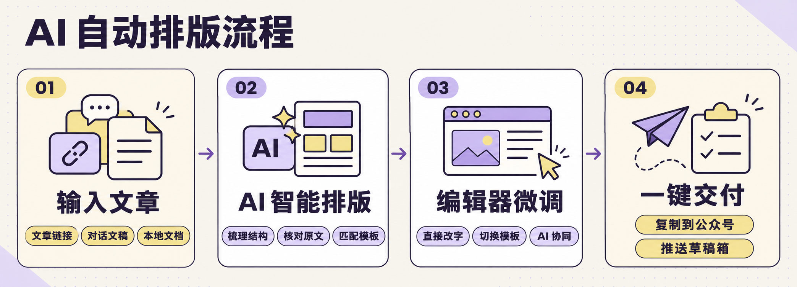
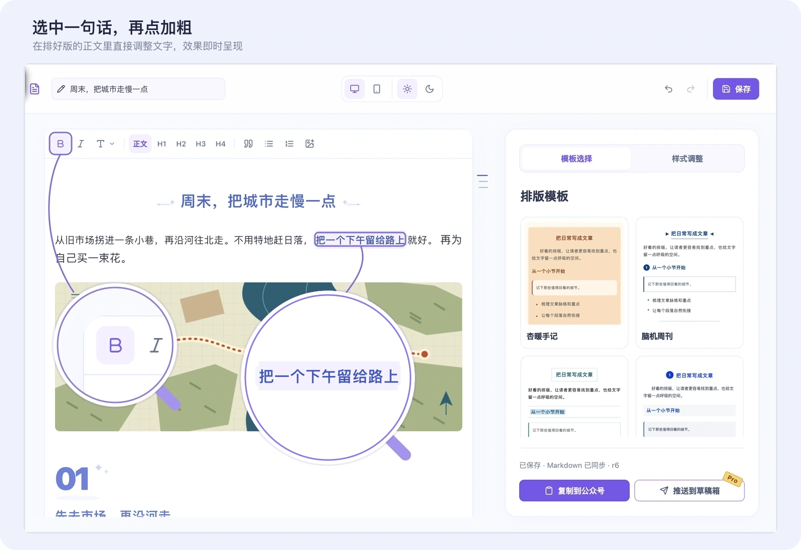
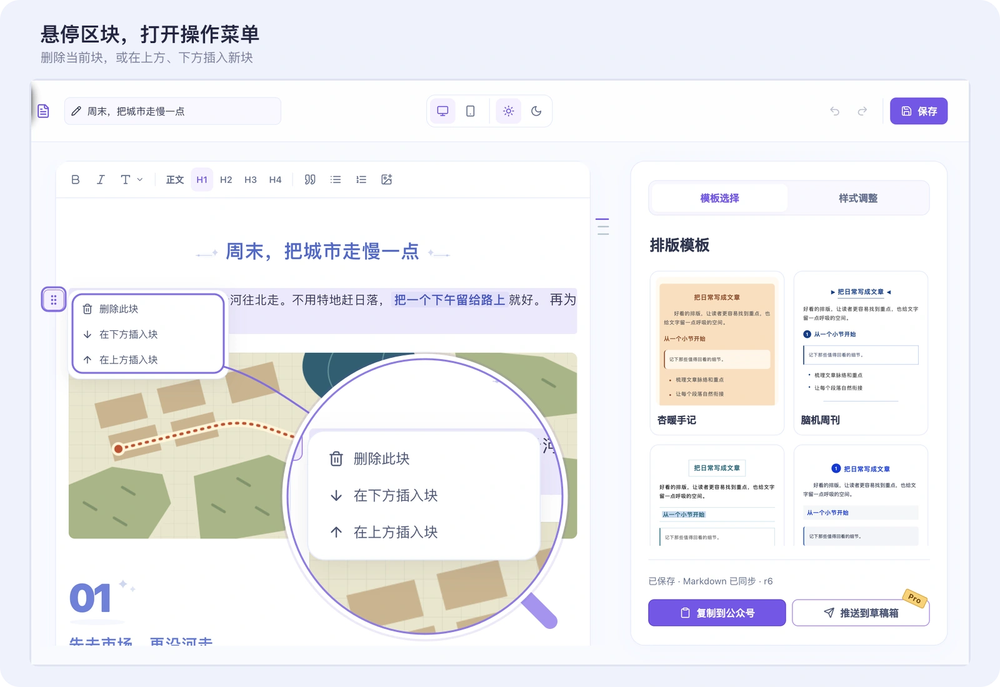
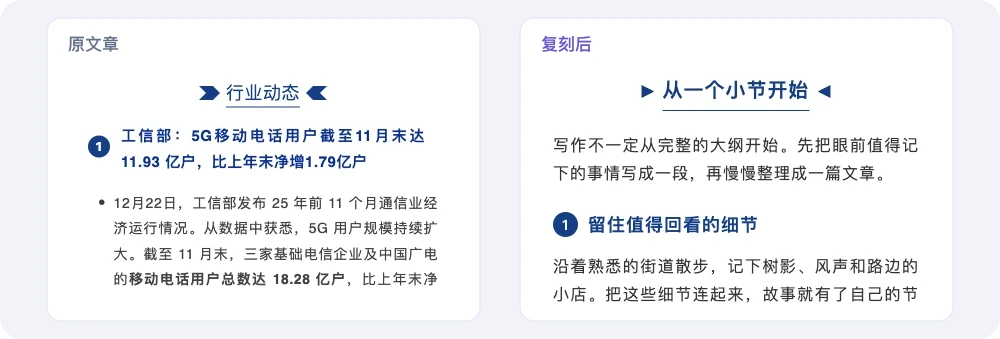
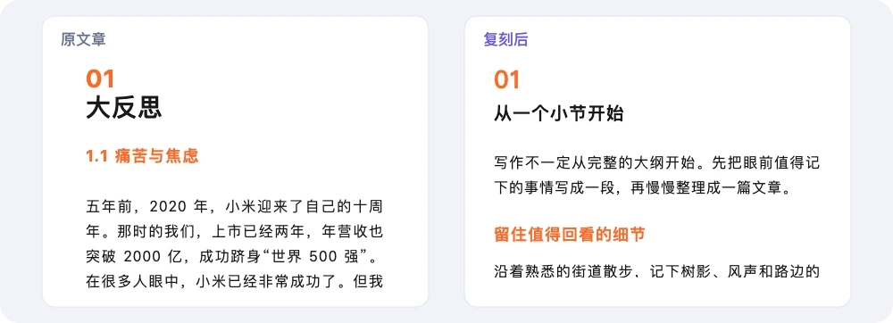
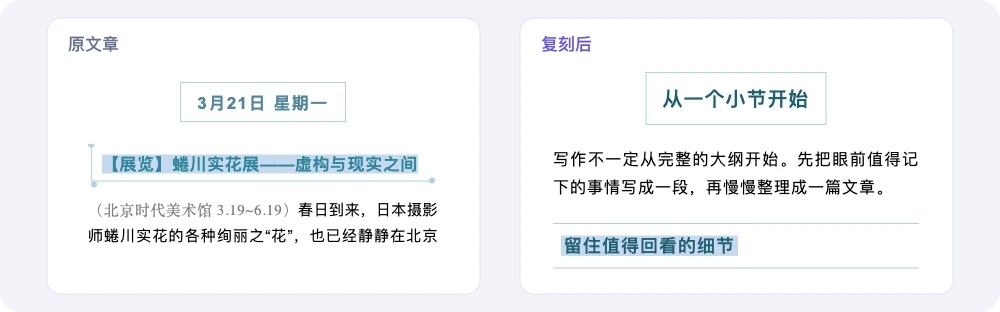
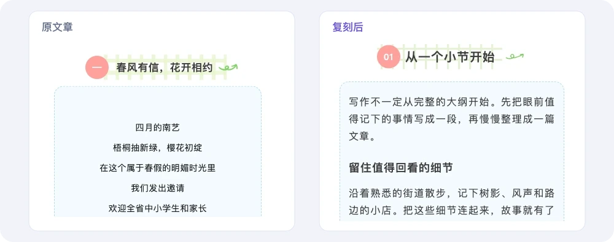

<p align="center">
  
</p>

<h1 align="center">把排版交给 AI，把时间留给内容</h1>

<p align="center">
  <strong>Ryan-WeStudio</strong> 是一个 AI 公众号排版 Skill，内置 19 套模板，帮你快速排好文章，支持后期微调。完成后可复制到公众号。
</p>

<p align="center">
  <a href="#安装方法">安装方法</a> · <a href="#如何使用">如何使用</a> · <a href="#开源版与-pro-版">开源版与 Pro 版</a> · <a href="#特色功能">特色功能</a> · <a href="#给-ai-agent-的安装指引">给 AI Agent 的安装指引</a>
</p>

## 安装方法

**直接让 AI Agent 帮你安装**

把下面这段话复制给你的 AI Agent，即可安装 Ryan-WeStudio：

```text
请帮我从这个 GitHub 仓库安装 ryan-westudio 公众号排版 Skill：
https://github.com/RyanChen1997/ryan-westudio

请先阅读仓库 README.md 末尾的「给 AI Agent 的安装指引」，并参照仓库中的 AI_INSTALL.md 将它安装到你当前环境的 Skills 目录。
完成依赖安装与构建后，确认你能识别 ryan-westudio，并告诉我怎么调用。
```

> [!TIP]
> **支持多种 AI Agent**：Cursor、GitHub Copilot、Antigravity、Claude Code、Codex、OpenCode、Kimi Code、Qoder、Workbuddy、豆包电脑版。

<p align="center">
  
</p>


## 如何使用

安装完成后，只要在对话里引用这个 Skill（`ryan-westudio`），就能让 AI 帮你完成公众号排版。常见有以下几种使用方式：

**方式一：直接把文章链接（或本地文稿）交给 AI 排版**

把现成的文章链接或本地 Markdown / Word 文档发给 AI，并引用本 Skill。链接是交给 Agent 读取的：它需要先把可访问的文章保存为本地 Markdown，并将要保留的配图保存为本地文件，再交给编辑器导入。

> 请用 `ryan-westudio` 帮我把这个链接里的文章排成公众号版式，排好后打开编辑器：`<文章链接或本地文稿路径>`

**方式二：把当前对话里 AI 刚写好的文章直接排版**

如果当前对话里 AI 刚刚帮你写完一篇文章（或改好初稿），无需手动导出文件，直接引用本 Skill 接着排版：

> 请用 `ryan-westudio` 把我们刚才在对话里写好的这篇文章排成公众号版式，并打开本地编辑器。

**方式三（Pro）：指定参考文章，复刻喜欢的版式来排版**

排版时还可以附带一篇你觉得好看的公众号文章链接，让 AI 先复刻它的版式再套用到你的文章上：

> 请用 `ryan-westudio` 帮我排版这篇文章，版式风格请复刻这篇公众号文章：`<参考公众号文章链接>`

<p align="center">
  
</p>

<sub>流程图同时展示两版；实际推送草稿箱仅限 Pro。</sub>

**调用 Skill 后，AI 会自动完成以下工作：**

1. **保存原稿基准**：在独立项目目录中冻结原文为只读对照快照并记录配图路径；导入时将可读取的本地配图保存到项目，不覆盖你的原文件。
2. **结构整理与原文核对**：AI 自动梳理标题层级、引用、列表与段落结构，可按需拟定公众号标题与摘要，并在首次整理后逐字核对原文，确保排版过程不改字、不漏字。
3. **匹配模板并打开编辑器**：根据文章主题智能推荐并套用合适的排版模板（Pro 也可套用已复刻的私人模板），随后在本地浏览器中启动所见即所得编辑器。
4. **编辑器微调与 AI 协同**：你可以在同一页面直接修改正文、一键切换模板、调整页边距或增删区块，也可以继续在对话里让 AI 调整样式、插入或替换本地图片。
5. **一键交付成稿**：排好后可直接无水印复制到公众号后台，也可[导出 HTML](references/ai-tools.md#保存与导出)。Pro 版还支持确认后推送到草稿箱（只创建草稿，不会自动群发）。本仓库提供的 Skill 中，「推送到草稿箱」按钮仅打开 Pro 介绍，不会传送稿件。

## 开源版与 Pro 版

**开源版**内置排版模板与本地所见即所得编辑器，支持从原稿导入、AI 自动排版、自由修改文字和样式，到与 AI 对话协作、添加本地图片、无水印复制到公众号的完整流程。

**Pro 版**提供更丰富的内置模板和专门的配图工作流，支持复刻其他公众号文章的排版并加入私人模板库，也能一键推送到公众号草稿箱。

| 功能 | 开源版 | Pro 版 |
| --- | :---: | :---: |
| 导入 Word / Markdown，保留可读取的本地配图（文章链接由 Agent 先转成本地文稿） | ✓ | ✓ |
| AI 自动排版，首次整理后核对原文 | ✓ | ✓ |
| 内置多套排版模板，支持一键切换版式 | 19 套 | 44 套 |
| 内置所见即所得编辑器，排版后可自由修改文字与样式 | ✓ | ✓ |
| AI 协同修改、手动插图与换图 | ✓ | ✓ |
| 让 AI 在编辑器中添加或替换本地图片 | ✓ | ✓ |
| 专门的 AI 配图工作流（通读全文、定基调、规划选图与制图） | — | ✓ |
| 无水印复制到公众号、导出 HTML | ✓ | ✓ |
| 复刻其他公众号文章的排版，并加入私人模板库 | — | ✓ |
| 确认后直接推送到公众号草稿箱 | — | ✓ |

**Pro 版：69 元。一次购买，永久使用，并可持续获取后续更新。** [购买 Pro 版](https://westudio.airyanchen.cc/)

## 特色功能

### 内置编辑器：排完之后，依然可以自己改

有些 AI 排版工具生成结果后，想改一句话、调整一个标题或换张图，还得回到原稿重新排版。ryan-westudio 把排版结果留在本地的所见即所得编辑器里：**直接点击正文就能修改文字，样式也可以继续调整**。

<p align="center">
  <a href="assets/readme/editor-text.webp"></a>
</p>

- **修改文字和结构**：直接编辑正文、调整标题层级，插入引用、列表和本地图片。
- **调整排版细节**：选中文字设置粗体、斜体或局部字号，在右侧调整页边距；也可以随时切换整套模板。
- **按块操作**：鼠标移到段落等区块，点击左侧操作柄，即可删除当前块，或在上方、下方插入新块。
- **继续和 AI 协作**：在同一个编辑会话里让 AI 调整排版、添加或替换本地图片，或授权它修改内容；改动自动保存，并同步到 Markdown。
- **直接复制当前内容**：不必重新生成或切换预览，编辑完成后复制到公众号。微信可能再次过滤样式，粘贴后仍需检查。

<p align="center">
  <a href="assets/readme/editor-block-menu.webp"></a>
</p>

<sub>以上为本地编辑器的实际操作截图，添加了标题、放大镜与指示线，并裁切或遮去浏览器扩展图标；点击图片可放大查看。切换模板会清除局部视觉微调，保留正文、语义结构和图片。</sub>

### 模板复刻：给一个参考，做成自己的模板（Pro）

看到喜欢的公众号排版，只需把文章链接或清晰截图发给 Agent，就能高还原度地复刻出神韵一致的专属版式——无论是精巧的章牌编号、标题与底板的层次关系，还是全文的色彩搭配、字距行距与留白节奏，都能精准捕捉并沉淀到你的私人模板库中，随时套用到自己的文章上。**复刻的是版式设计与视觉美感，不搬运对方的文字与图片。**

**六套公众号文章复刻对照** · 左侧是公众号原文的版式局部，右侧是套用对应模板后导出的[同一篇样稿](assets/readme/samples/clone-demo.md)。点击图片可放大查看。这里展示的是 Pro 的复刻能力；本仓库内置的 [19 套模板](references/style-presets.md) 可在编辑器中选用。

<p align="center">
  <a href="assets/readme/clone-wechat-frost-chrysanthemum.webp"></a>
  <a href="assets/readme/clone-wechat-bci-weekly.webp"></a>
  <a href="assets/readme/clone-wechat-xiaomi-keynote.webp"></a>
  <a href="assets/readme/clone-wechat-beijing-art-calendar.webp"></a>
  <a href="assets/readme/clone-wechat-nua-spring-tour.webp"></a>
  <a href="assets/readme/clone-wechat-spring-art-guide.webp"></a>
</p>

**复刻流程**

为了让复刻出的模板既高度还原参考文章的视觉质感，又能在不同文章长度和手机屏幕上稳定呈现，每一次模板复刻都会经历完整的「视觉拆解—独立试排—子 Agent 盲评打分—达标入库」流程：

1. **视觉拆解与规律提炼**：AI 打开参考文章，观察题头、典型章节与文末收尾，剥离原文的具体文字、配图与平台外壳，提炼出最具辨识度的配色体系、标题层级、装饰元素、正文行距与图文留白规律。
2. **生成候选模板与多端试排**：将提炼出的设计规则转化为编辑器可复用的版式结构与本地高清装饰素材，并在隔离环境中用标准样稿进行桌面端、手机端、窄屏长标题折行与深色模式的实机试排。
3. **独立子 Agent 盲评打分**：初版完成后不会直接交付，系统会启动一个**独立的 Reviewer 子 Agent**，对照参考原文截图与试排渲染成稿，从**视觉辨识度（25 分）、整体调性（20 分）、层级与阅读节奏（15 分）、多端适配（15 分）、内容保真与导出一致性（10 分）、同调性延展（10 分）、流程与复现证据（5 分）**七个维度进行严格打分。
4. **未达标自动打回迭代，高分入库套用**：只有总分 **大于 85 分（满分 100 分）**、核心辨识度与整体调性双双过线，且确认无遮挡压字、断图或误改原文等硬性问题时才算通过；若评分未过线，主 Agent 会根据子 Agent 的扣分项自动调整细节并重新送审。通过验收后，新模板会自动存入你的**私人模板库**，并一键套用到当前文章中。

## 给 AI Agent 的安装指引

> 🤖 **本节供 AI Agent 阅读**：当用户要求你安装或更新 `ryan-westudio` 时，请直接读取本仓库根目录下的 [`AI_INSTALL.md`](AI_INSTALL.md)，严格按照文档中的步骤完成环境检查、宿主 Skills 目录定位、已有安装保护、`npm ci --include=dev && npm run build` 构建及安装验证，完成后向用户汇报调用方式。日常使用请遵循本仓库的 [`SKILL.md`](SKILL.md)。
